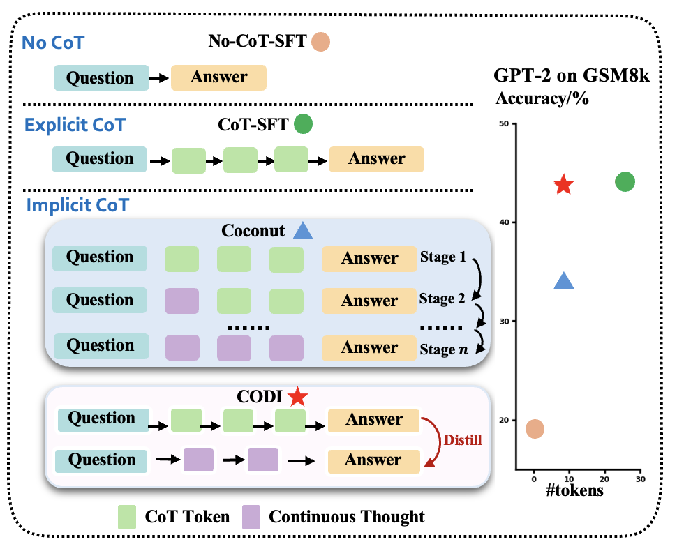

## CODI 论文概述
先前学习的CoT方法是通过自然语言token来进行推理的。然而先前的提示学习工作已表明将离散提示转换为连续表示可以带来高效而有效的推理。Coconut(Chain of Continuous Thought)虽然以一种巧妙的思路超越了早期隐式CoT方法，但是存在着由于多阶段课程学习带来的遗忘问题。而本论文提出的CODI(Continuous Chain-of-Thought via Self Distillation)借助自蒸馏，将CoT推理能力蒸馏到隐式CoT推理行为中，在单阶段内完成。



CODI并不将teacher和student的序列token完全对齐，而是对齐"The answer is:"里的冒号":". 且这个操作具有较好的鲁棒性。CODI 的独特之处在于允许在潜在空间而非自然语言中推理，这在以往知识蒸馏工作中很少被探索。这一创新使推理更灵活、更高效。其问题则在于选择"冒号"作为对齐token的局限性（有的回答并不一定以此为开头），另一个局限是在序列结束之前缺乏中间梯度。

## 论文复现
我选择在RTX 4060 Laptop 8GB上使用GPT-2 124M复现了 CODI 的推理流程。teacher和student的处理如下：
```python
# teacher读完整文字CoT
# 最后一步先删掉，防止走捷径抄答案
teacher_ids = Q + cot[:-1] + answer        # answer = "The answer is: 360"

# student只读6个连续向量
student_enc = Q + [bot_id]                 # z1 = h(<bot>)
student_dec = [eot_id] + answer            # 从 <eot> 开始生成答案

# teacher的交叉熵损失只算CoT+answer, student的交叉熵损失只算answer
teacher_labels[:len(Q)] = -100
```

冒号处逐层对齐处理具体如下：
```python
# 两者都在 "The answer is:" 的冒号处取 hidden
t_h = teacher_out.hidden_states
s_h = student_out.hidden_states
t_pos, s_pos = colon_pos(teacher_ids), colon_pos(student_ids)

kd = 0
for h_t, h_s in zip(t_h, s_h):
    t = h_t.gather(1, t_pos).detach()    # teacher不回传
    s = h_s.gather(1, s_pos)
    kd += SmoothL1(s, t) / t.std()       # 逐层尺度归一化
kd /= len(t_h)
```

做了一些问题的测试，结果如下：
```zsh
--- Q1 (0.19s) ---
Q: Natalia sold clips to 48 of her friends in April, and then she sold half as many clips in May. How many clips did Natalia sell altogether in April and May?
A: The answer is: 72
pred=72 gold=72 OK
  z1: |h|=51.5   top5=['/', ',', '>>', '.', '—']
  z2: |h|=40.25  top5=['24', ' 24', 'ree', 'rip', 'ret']
  z3: |h|=57.75  top5=[',', '>>', '/', ')', '—']
  z4: |h|=40.25  top5=['24', ' 24', 'ree', 'rip', 'ren']
  z5: |h|=68.0   top5=[')', '>>', ',', '/', '—']
  z6: |h|=38.0   top5=['24', ' 24', 'ree', 'rip', 'ren']

--- Q2 (0.07s) ---
Q: Weng earns $12 an hour for babysitting. Yesterday, she just did 50 minutes of babysitting. How much did she earn?
A: The answer is: 10
pred=10 gold=10 OK
  z1: |h|=43.25  top5=['/', ',', '>>', 'WR', '?']
  z2: |h|=61.0   top5=[']', ' [', '0', ' 0', ',']
  z3: |h|=39.25  top5=['>>', '|', '.', '/', ',']
  z4: |h|=54.25  top5=[']', '0', 'yl', '83', ' [']
  z5: |h|=40.25  top5=['>>', '.', '|', '%', ',']
  z6: |h|=51.0   top5=[']', '0', 'yl', '83', ' [']

--- Q3 (0.06s) ---
Q: Betty is saving money for a new wallet which costs $100. Betty has only half of the money she needs. Her parents decided to giveher $15 for that purpose, and her grandparents twice as much as her parents. How much more money does Betty need to buy the wallet?
A: The answer is: 5
pred=5 gold=5 OK
  z1: |h|=35.0   top5=['.', '*', '>>', '+', '=']
  z2: |h|=49.75  top5=[' 30', '30', ' 15', 'ess', ' add']
  z3: |h|=53.0   top5=[' comes', ' begins', ' is', ' fails', ' starts']
  z4: |h|=49.5   top5=['95', ' 95', ' yes', ' well', ' still']
  z5: |h|=34.25  top5=[',', '!', '.', '+', '...']
  z6: |h|=37.75  top5=['95', ' 95', '105', '100', '115']

--- Q4 (0.06s) ---
Q: A robe takes 2 bolts of blue fiber and half that much white fiber. How many bolts in total does it take?
A: The answer is: 3
pred=3 gold=3 OK
  z1: |h|=77.5   top5=['/', '>>', '.', ',', '—']
  z2: |h|=27.88  top5=[' 1', '1', ' 0', '0', '>>']
  z3: |h|=42.75  top5=['>>', ',', ')', '/', '.']
  z4: |h|=28.75  top5=['1', ' 1', '0', ' 0', ' 2']
  z5: |h|=44.0   top5=['>>', ')', '/', ',', '),']
  z6: |h|=26.75  top5=['1', ' 1', '0', ' 0', '2']

--- Q5 (0.06s) ---
Q: James writes a 3-page letter to 2 different friends twice a week. How many pages does he write a year?
A: The answer is: 624
pred=624 gold=624 OK
  z1: |h|=53.0   top5=['>>', '*', '-', '"', '**']
  z2: |h|=31.62  top5=[' 12', '12', ' copy', 'rip', ' 36']
  z3: |h|=51.0   top5=['>>', '-', '""', '"', '*']
  z4: |h|=31.5   top5=[' 12', '12', ' 24', ' 36', ' 6']
  z5: |h|=42.5   top5=['>>', '-', '"', '""', '*']
  z6: |h|=28.75  top5=[' 12', '12', ' 24', ' 6', ' 36']

accuracy: 5/5
peak GPU allocated: 0.32 GiB
```