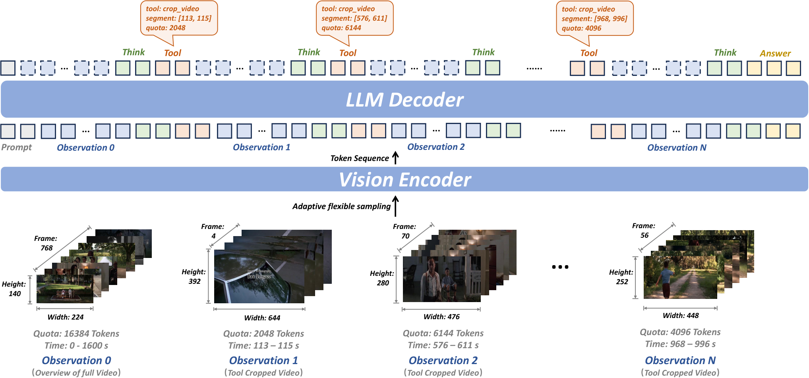

## Video-o3 论文概述
面向长视频理解的多模态大语言模型目前主要依赖均匀采样与单轮推理，这使它们难以在大量冗余内容中识别稀疏却关键的证据。本篇论文提出的新框架 Video-o3 则在解决这一问题。该框架支持迭代式发现视觉线索、对关键片段进行细致的检查，并在获得足够证据后自动终止。

如同人脑一般，想要在一个较长视频中发现答案，应该是粗略的扫一遍整体，再对有线索的部分进行更细致的检查，如果没有答案。则进行迭代的思考。Video-o3的整体架构如图: 



在首次交互中，模型接收工具使用说明、用户查询以及视频的全局视图，对视频有整体的浏览。之后，模型进入内部推理，评估当前观察是否充分，进入下列分支：
1. 线索搜寻（Clue Seeking）：如果现有线索含糊或不充分，模型调用工具仔细检查某个视频片段的细粒度细节，从而消除不确定性。
2. 答案推理（Answer Reasoning）：如果已找到清晰的视觉证据足以支撑答案，模型直接生成最终回答。

模型还做了其他的处理：
1. 任务解耦冷启动：由于长视频推理的上下文缓冲区会混杂着低分辨率全局视频 token、工具返回的细粒度局部片段以及中间推理文本，导致注意力可能被无关的上下文带偏。因此，模型被施加了可见性约束：在作答阶段屏蔽全局概览以防止伪思考；在工具调用规划阶段屏蔽局部工具输出。
2. 轨迹引导强化学习：模型被引入了融合了答案正确、格式有效、轮次较少的奖励机制，促使模型更简洁、更快速、更精确地找到正确的答案。

在这些机制的帮助下，Video-o3已经在多个基准上刷新了MLLM的视频理解能力。

## 论文复现
本机的4060显卡跑不通这种推理，因此我选择了在云服务平台租了32g显存的的4080来实现推理，虽然服务器的网络质量太差下载很慢，但是最后还是跑通了。

运行脚本如下：

```python
import cv2
from vlmeval.vlm.video_o3.model import VideoO3Chat
from vlmeval.vlm.video_o3.prompt import (
    VIDEO_INSERT_PROMPT,
    QUESTION_TEMPLATE_MULTI_ROUND_MC,
)

VIDEO = "/root/autodl-tmp/videos/sakki.mp4"
CKPT  = "/root/autodl-tmp/models/Video-o3_SFT_RL"

cap = cv2.VideoCapture(VIDEO)
fps = cap.get(cv2.CAP_PROP_FPS) or 25.0
frames = int(cap.get(cv2.CAP_PROP_FRAME_COUNT))
cap.release()
duration = frames / fps if frames else 0.0

QUESTION = "Is the cup in the hand of the person in the video the same as the one at the end at seconds 30–40 of the video?"
OPTIONS  = "A. yes\nB. no"

model = VideoO3Chat(
    model_path=CKPT,
    min_pixels=20 * 28 * 28,
    max_pixels=768 * 28 * 28,
    total_pixels=16384 * 28 * 28,
    use_tools=True,
    use_dynamic_quota=True,
    max_turn=8,
    max_new_tokens=4096,
)

prompt = (
    VIDEO_INSERT_PROMPT.format(
        sample_fps=2.0, total_frames=duration * 2.0, max_duration=duration
    )
    + QUESTION_TEMPLATE_MULTI_ROUND_MC.format(question=QUESTION, options=OPTIONS)
)

message = [
    dict(type="raw_video", value=VIDEO),
    dict(type="video", value=VIDEO,
         min_pixels=20 * 28 * 28,
         max_pixels=768 * 28 * 28,
         total_pixels=16384 * 28 * 28),
    dict(type="text", value=prompt),
]

print(model.generate_inner(message))
```

其中`sakki.mp4`是一段一个人手持水杯唱歌的视频。`QUESTION`最先为"Does the person in the video always hold the same cup?"，但是模型只通过全局浏览视频便直接得出了答案。换为新的问题之后，模型在Round 1阶段裁剪了视频片段，其每帧的信息密度远大于Round 0, 也调用了工具：

> `<grounding>{"temporal_segment": [0, 10], "sampling_strategy": "medium"}</grounding>`

最终得出正确结果。